# dth: intraday futures trading engine

**One code path for research, live paper trading and broker execution, with look-ahead detection built in.**

`dth` trades CME index futures (E-mini S&P 500 / Nasdaq-100 via the MES / MNQ micros) on 1-minute bars. A strategy is
a pure function of the bars it is allowed to see. The same function runs:

- in the backtest;
- in the minute-by-minute live trader;
- behind a real broker connection.

The engine proves on every run that the three agree. The tool also simulates the rules of a **prop-firm evaluation
account**: trailing drawdown, pass target, funded phase, payouts. It then measures a strategy by what it would earn
under those rules, not by an equity curve with unlimited capital.

> [!IMPORTANT]
> **This public repository is only a sketch.** It shows the engine plus an example plan made of two textbook
> strategies. The example plan is weak, has no proven edge, and should not be traded.
>
> **My private version is a much better tool:**
> - it **places the orders by itself** on the broker account;
> - it runs a production plan of carefully selected strategies;
> - it is **backed by 7+ years of 1-minute ES / NQ data (2019-2026)**;
> - it passed strict out-of-sample tests, coin-flip controls and stress tests.
>
> If you are interested in it, **contact me on LinkedIn:
> [Maor Moshe Shalom](https://www.linkedin.com/in/maor-moshe-shalom-a961141b1)**.

> Copyright (c) 2026 Maor Moshe Shalom. All rights reserved. This repository is published for **viewing only**. See
> [LICENSE](LICENSE). Nothing here is financial advice.

---

## Overview & architecture

```mermaid
flowchart LR
    subgraph Data
        Y[Yahoo / broker REST<br/>1-min bars] --> S[(monthly CSV store<br/>append-only)]
        CAL[economic calendar<br/>no-trade days] --> D
        S --> D[Day builder<br/>RTH + overnight arrays<br/>context known before 09:30]
    end
    subgraph Core["Strategy core (pure functions)"]
        D --> SN[snapshot&#40;day, T&#41;<br/>closed bars only]
        SN --> ST[strategies<br/>f&#40;day&#41; -> Trade]
        ST --> STEP[Stepper<br/>entry / exit events<br/>+ look-ahead detector]
        STEP --> G[OneAtATime gate<br/>priority on ties]
    end
    G --> ACC[PropAccount<br/>sizing, trailing limit,<br/>test / funded / payouts]
    ACC --> BR{Broker}
    BR --> P[PaperBroker<br/>order log]
    BR --> PX[ProjectXBroker<br/>Topstep REST API]
    ACC --> BOOK[Trade picture book<br/>entry + exit charts per trade]
```



**Layers** (each one depends only on the layers to its left):

| Layer | Module | Responsibility |
|---|---|---|
| Data | `dth/data.py`, `dth/calendar.py` | An append-only monthly store of 1-minute bars (it never overwrites history, so the data accumulates from sources that only serve ~30 days), and a no-trade calendar (holidays, CPI / PPI / PCE / NFP / FOMC). |
| Domain model | `dth/lab/days.py` | One immutable-by-convention `Day` per CME trade date. It holds NumPy arrays for the regular and overnight sessions, plus a context dict of **only** what is known before the open (prior OHLC, ATR, intraday volatility profile). Built once and cached under a content hash of the data and code. |
| Simulation | `dth/lab/sim.py` | The shared trade simulator: stop / target / time exits, round-trip costs, and conservative fills. When a stop and a target are touched in the same bar, it assumes the stop. |
| Strategies | `dth/lab/examples.py` | Pure `f(day, ...) -> Trade | None`. No I/O, no state, no clock. |
| Plans | `dth/lab/system.py` | A registry of `(trades function, components, priority)`. Production plans plug in from an optional private module without touching the engine. |
| Live engine | `dth/live/engine.py` | `snapshot(day, T)` hides every bar that has not closed by minute `T` and every same-day statistic. The `Stepper` turns the strategy output at each minute into entry / exit **events**. A signal that is not born on the last closed bar, or that changes or disappears after it appeared, is recorded as a **look-ahead violation**. |
| Risk & account | `dth/live/account.py` | The prop-firm account state machine: risk-% sizing on a risk distance (stop or ATR unit), contract caps, trailing limit, daily loss stop, the test → funded transition and payouts. |
| Execution | `dth/live/runner.py`, `broker.py`, `projectx.py` | `PaperTrader` is a restartable session. It persists state every minute and converges the broker to a **target net position** per symbol (idempotent: re-sending the same target is a no-op). |
| Ops | `scripts/autotrade.py`, `scripts/*.ps1` | The scheduled, self-healing daily run, status / stop / start controls and the kill switch. |

### Design decisions

- **Backtest == live, by construction and by test.** There is one strategy implementation. The live trader calls it on
  growing snapshots, minute by minute. `autotrade.py --replay-day` and `tests/test_engine.py` feed stored days through
  the live trader and assert that the events equal the replay's exactly, with zero look-ahead violations.
- **Event-sourced, crash-safe live session.** Accounts and steppers are pickled after every minute.
  - A killed process restarts and steps the missed minutes in order.
  - A day that was never finished is completed later from stored bars. Since strategies only see closed bars, the result
    is identical to the uninterrupted run, and `tests/test_demo.py` asserts it.
- **Broker as a target-position reconciler.** The trader never sends "buy 3". It sends "the net position should be
  −2". `ProjectXBroker`:
  - places the market entry;
  - immediately parks a protective **stop order at the broker** (rounded away from the market to the tick grid), so a
    crash or a lost connection never leaves an unprotected position;
  - cancels the stop and closes the position on exit;
  - reconciles every minute: if the broker's stop has filled, it does not re-enter; any position it did not ask for, it
    closes.
- **Safety rails.** Practice accounts only unless explicitly allowed, a contract cap, a daily account-loss stop, a
  forced flat before the close, a file-based kill switch, and a per-day stop flag. On the ops side, a hidden
  scheduler restarts the process every 10 minutes if it is not running.
- **Validation over curve-fitting.** Plans are accepted only under a strict protocol, run by validation scripts that
  live with the private plans:
  - choose on one period, judge on a later one ("pick on 2019-2022, must be profitable in *every* year 2023-2026");
  - coin-flip controls (the same trades with random outcomes);
  - bootstrap of 12-month paths;
  - start-date dispersion of the account results;
  - stress tests: entries one bar late, costs ×2 and ×3.

## Performance & computational highlights

- **Vectorised bar arrays.** Every session is a set of contiguous NumPy arrays (`Bars.t/o/h/l/c/v`). Window queries are
  `searchsorted` on the minute index, and snapshots are O(1) array views. Strategies never iterate over pandas rows.
- **Content-addressed caching** (`dth/runcache.py`). Built `Day` objects and full-history minute-by-minute replays are
  keyed by a hash of the data files plus the code that produced them. Re-running is free until the data or that code
  changes, and then the cache is recomputed automatically.
- **Parallel fan-out.** A full replay of ~2,000 trading days × 390 minutes (~780k minute steps per plan, each one
  evaluating every strategy of the plan on that minute's snapshot) is chunked across a `ProcessPoolExecutor`. The picture book renders thousands of charts in parallel
  (headless matplotlib, one figure per worker task).
- **Incremental, idempotent builds.** The picture book draws only missing images. The live book redraws a trade's
  picture when it opens (OPEN) and once more when it closes (WIN / LOSS), then refreshes the month pages and the index.
- **Bounded network use.** At start-up the live loop backfills once from the free data source. After that it makes a
  single small request per minute. The broker client keeps within the API's documented rate limits (backs off on HTTP
  429, refreshes its token on HTTP 401).

## Tech stack

| Area | Tools |
|---|---|
| Language | Python 3.11+ (type hints, dataclasses, `zoneinfo`) |
| Numerics / data | NumPy, pandas |
| Charts | matplotlib (Agg, rendered in parallel worker processes) |
| Market data | Yahoo Finance via `yfinance`; the Topstep / ProjectX Gateway REST API via `requests` |
| Concurrency | `concurrent.futures.ProcessPoolExecutor` |
| Testing | pytest, with synthetic market data generated per test session; a fake broker for the order logic |
| Ops (Windows) | Task Scheduler via PowerShell (wake-to-run, repetition, per-user hidden process), batch launchers |

## Getting started

```bash
pip install -r requirements.txt
python -m pytest                                   # 23 tests on synthetic data, ~5 s

python scripts/make_sample_data.py                 # synthetic ES/NQ 1-minute bars -> data/raw/
python scripts/autotrade.py --replay-day 2025-04-15   # a stored day through the live trader: must print IDENTICAL
python scripts/trade_book.py --plan example --no-zip   # a picture of every trade -> reports/trade_book/index.html
python scripts/autotrade.py                        # live paper trading (real-time with real data; see DATA.md)
```

The synthetic data has no edge by construction. It exists to exercise the machinery. For real data see
[DATA.md](DATA.md).

### How a live day flows

1. **15:15 local** (configurable): the scheduler starts `autotrade.py`, hidden. It loads the saved accounts, finishes any
   unfinished earlier day from stored bars, and waits for 09:30 New York.
2. **Every minute:**
   - fetch the newest closed bar;
   - build the day snapshot;
   - each plan's strategies produce trades;
   - the Stepper emits only *new* entries and *final* exits;
   - the gate keeps one trade at a time;
   - the account sizes the trade;
   - the broker converges to the new net position.
3. **On each event:** the order goes into the log, and the trade's picture is (re)drawn. The month page and
   `index.html` are rewritten.
4. **After 16:00:** wait for the last bars, finish the day exactly, save, and exit. Repeat runs of the scheduler that
   day see that the day is done and exit at once.

## Repository layout

```
dth/
  data.py, calendar.py        market data store, no-trade calendar
  runcache.py                 content-addressed cache keys
  lab/  days.py sim.py        Day model + trade simulator
        examples.py system.py textbook strategies + plan registry
  live/ engine.py             snapshots, Stepper (look-ahead detector), one-at-a-time gate
        account.py            prop-firm account state machine
        runner.py broker.py   restartable live session, broker interface
        projectx.py           Topstep / ProjectX REST adapter
scripts/                      live trader, picture book, replay, scheduler + controls, broker setup, sample data
tests/                        engine invariants, broker logic (fake account), restart / catch-up / live pictures
```

## Status

This public repository is a **sketch**. It contains the engine, the execution layer and an example plan built from two
published strategies:
- Zarattini & Aziz (2023), opening-range breakout;
- Gao, Han, Li & Zhou (2018), intraday momentum.

The example plan only demonstrates the machinery and is not worth trading.

The **private version** is developed in a private repository:
- it trades by itself, placing and managing the orders on the broker account;
- it runs a production plan of carefully selected strategies;
- it was validated with the protocol above on 7+ years of 1-minute data (2019-2026);
- it is currently running as a forward test.

To ask about the private version, contact me on
[LinkedIn](https://www.linkedin.com/in/maor-moshe-shalom-a961141b1).

---

*Trading futures involves substantial risk of loss. Backtests and paper results are not indicative of future results.*
